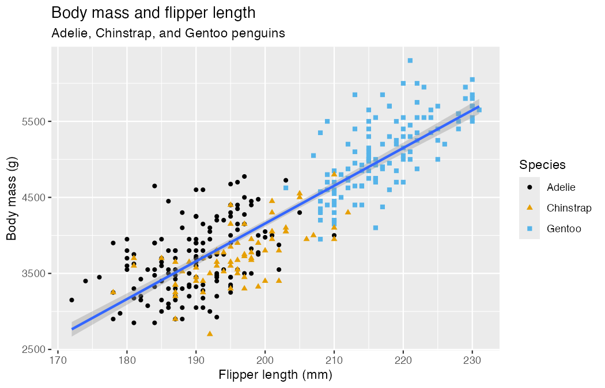



## Before you start {.unnumbered}

::: {.pair}
**Work in pairs, one laptop.** The **driver** types. The **navigator** reads the
task aloud and says what to type. Swap at every [Swap]{.swap-chip}.
:::

Grey boxes are live R. Edit, then **Run Code**. The first run takes a few seconds.

Based on Wickham, Çetinkaya-Rundel & Grolemund, [*R for Data Science* (2e), ch. 1](https://r4ds.hadley.nz/data-visualize.html).

## 1. The data

```{webr}
library(ggplot2)
library(palmerpenguins)
penguins
```

| Column | What it is |
|---|---|
| `species` | Adelie, Chinstrap or Gentoo |
| `island` | Biscoe, Dream or Torgersen |
| `bill_length_mm`, `bill_depth_mm` | bill size |
| `flipper_length_mm` | flipper length |
| `body_mass_g` | body mass |
| `sex`, `year` | sex and year observed |

::: {.turn}
**Your turn.** How many rows and columns does `penguins` have?
:::

```{webr}
#| exercise: ex_dim
______(penguins)
```

::: {.solution exercise="ex_dim"}
**Solution:**

```r
dim(penguins)
```

344 rows (penguins), 8 columns (variables).
:::

## 2. The goal

By the end of section 3 you will have rebuilt this plot.

{fig-alt="Scatterplot of body mass against flipper length, points colored and shaped by species, with one linear trend line."}

## 3. Build a plot, layer by layer

Every ggplot has three parts:

```r
ggplot(data = <DATA>, mapping = aes(<MAPPINGS>)) +
  <GEOM_FUNCTION>()
```

**Step 1 --- data.** An empty canvas.

```{webr}
ggplot(data = penguins)
```

**Step 2 --- mapping.** `aes()` links columns to axes.

```{webr}
ggplot(
  data = penguins,
  mapping = aes(x = flipper_length_mm, y = body_mass_g)
)
```

**Step 3 --- geom.** How to draw each row.

```{webr}
ggplot(
  data = penguins,
  mapping = aes(x = flipper_length_mm, y = body_mass_g)
) +
  geom_point()
```

::: {.turn}
**Talk it over.** Describe the relationship in one sentence. The warning
mentions 2 rows --- why?
:::

::: {.callout-tip collapse="true"}
## Solution
Heavier penguins have longer flippers: a strong positive relationship. Two
penguins have no flipper length or body mass recorded (`NA`), so they cannot be
plotted.
:::

**Step 4 --- color.** Map a third variable.

```{webr}
ggplot(
  data = penguins,
  mapping = aes(x = flipper_length_mm, y = body_mass_g,
                color = species)
) +
  geom_point()
```

**Step 5 --- a second layer.** Add a trend line.

```{webr}
ggplot(
  data = penguins,
  mapping = aes(x = flipper_length_mm, y = body_mass_g,
                color = species)
) +
  geom_point() +
  geom_smooth(method = "lm")
```

::: {.turn}
**Talk it over.** Why three lines? The goal has one.
:::

::: {.callout-tip collapse="true"}
## Solution
`color = species` sits in `ggplot()`, so it applies to every layer, and
`geom_smooth()` fits one line per species.
:::

Mappings in `ggplot()` apply to **every** layer. Mappings inside a geom apply
to **that layer only**.

```{webr}
ggplot(
  data = penguins,
  mapping = aes(x = flipper_length_mm, y = body_mass_g)
) +
  geom_point(mapping = aes(color = species)) +
  geom_smooth(method = "lm")
```

[Swap]{.swap-chip}

::: {.turn}
**Your turn.** Finish the goal plot: add `shape = species`, labels with
`labs()`, and the colorblind-safe palette `scale_color_colorblind()` (from
**ggthemes**).
:::

```{webr}
#| exercise: ex_goal
library(ggthemes)
ggplot(
  data = penguins,
  mapping = aes(x = flipper_length_mm, y = body_mass_g)
) +
  geom_point(mapping = aes(color = species, shape = ______)) +
  geom_smooth(method = "lm") +
  labs(
    title = "Body mass and flipper length",
    subtitle = "Adelie, Chinstrap, and Gentoo penguins",
    x = "Flipper length (mm)", y = "Body mass (g)",
    color = "Species", shape = "Species"
  ) +
  ______()
```

::: {.solution exercise="ex_goal"}
**Solution:**

```r
library(ggthemes)
ggplot(
  data = penguins,
  mapping = aes(x = flipper_length_mm, y = body_mass_g)
) +
  geom_point(mapping = aes(color = species, shape = species)) +
  geom_smooth(method = "lm") +
  labs(
    title = "Body mass and flipper length",
    subtitle = "Adelie, Chinstrap, and Gentoo penguins",
    x = "Flipper length (mm)", y = "Body mass (g)",
    color = "Species", shape = "Species"
  ) +
  scale_color_colorblind()
```
:::

::: {.turn}
**Your turn.** Plot `bill_depth_mm` (y) against `bill_length_mm` (x). Describe
what you see.
:::

```{webr}
#| exercise: ex_bill
ggplot(penguins, aes(x = ______, y = ______)) +
  geom_point()
```

::: {.solution exercise="ex_bill"}
**Solution:**

```r
ggplot(penguins, aes(x = bill_length_mm, y = bill_depth_mm)) +
  geom_point()
```

Overall, a weak negative trend --- until you color by species (section 5).
:::

::: {.turn}
**Your turn.** This errors. Why? Fix it.
:::

```{webr}
#| exercise: ex_error
ggplot(data = penguins) +
  geom_point()
```

::::: {.hint exercise="ex_error"}
::: {.callout-tip collapse="false"}
## Hint
What should go on the x and y axes?
:::
:::::

::: {.solution exercise="ex_error"}
**Solution:**

`geom_point()` needs `x` and `y`. Add a mapping:

```r
ggplot(
  data = penguins,
  mapping = aes(x = flipper_length_mm, y = body_mass_g)
) +
  geom_point()
```
:::

::: {.turn}
**Predict first, then run.** What will this look like?
:::

```{webr}
#| exercise: ex_predict
ggplot(penguins, aes(x = flipper_length_mm, y = body_mass_g,
                     color = island)) +
  geom_point() +
  geom_smooth(se = FALSE)
```

::: {.solution exercise="ex_predict"}
**Solution:**

Points colored by island, one smooth **curve** per island (`color` is global),
no grey confidence band (`se = FALSE`).
:::

::: {.callout-note}
## Shorter code
The first two arguments are always `data` and `mapping`, so you can drop
their names:

```r
ggplot(penguins, aes(x = flipper_length_mm, y = body_mass_g)) +
  geom_point()
```
:::

## 4. One variable: distributions

[Swap]{.swap-chip}

**Categorical → bar chart.**

```{webr}
ggplot(penguins, aes(x = species)) +
  geom_bar()
```

Order bars by frequency with `fct_infreq()` (from **forcats**):

```{webr}
library(forcats)
ggplot(penguins, aes(x = fct_infreq(species))) +
  geom_bar()
```

**Numerical → histogram.** `binwidth` sets the width of each bar.

```{webr}
ggplot(penguins, aes(x = body_mass_g)) +
  geom_histogram(binwidth = 200)
```

**Numerical → density.** A smoothed histogram.

```{webr}
ggplot(penguins, aes(x = body_mass_g)) +
  geom_density()
```

::: {.turn}
**Your turn.** Put `species` on the **y** axis. What changes?
:::

```{webr}
#| exercise: ex_bar_y
ggplot(penguins, aes(______ = species)) +
  geom_bar()
```

::: {.solution exercise="ex_bar_y"}
**Solution:**

```r
ggplot(penguins, aes(y = species)) +
  geom_bar()
```

Horizontal bars. Handy when labels are long.
:::

::: {.turn}
**Your turn.** Run both. Which one is useful?
:::

```{webr}
#| exercise: ex_color_fill
ggplot(penguins, aes(x = species)) +
  geom_bar(color = "red")

ggplot(penguins, aes(x = species)) +
  geom_bar(fill = "red")
```

::: {.solution exercise="ex_color_fill"}
**Solution:**

`color` paints the outline; `fill` paints the inside. For bars, use `fill`.

Note: `"red"` sits **outside** `aes()` --- it is a fixed value, not a mapping
to a column.
:::

::: {.turn}
**Your turn.** Histogram of `carat` in the `diamonds` data (built into
ggplot2). Try `binwidth` values of 1, 0.1 and 0.01. Which shows the most?
:::

```{webr}
#| exercise: ex_carat
ggplot(diamonds, aes(x = carat)) +
  geom_histogram(binwidth = ______)
```

::: {.solution exercise="ex_carat"}
**Solution:**

```r
ggplot(diamonds, aes(x = carat)) +
  geom_histogram(binwidth = 0.01)
```

At 0.01 you see spikes at round sizes (0.3, 0.5, 1, 1.5, 2 carats). Too wide
a bin hides them.
:::

## 5. Two or more variables: relationships

[Swap]{.swap-chip}

**Numerical + categorical → boxplot or density.**

```{webr}
ggplot(penguins, aes(x = species, y = body_mass_g)) +
  geom_boxplot()
```

```{webr}
ggplot(penguins, aes(x = body_mass_g,
                     color = species, fill = species)) +
  geom_density(alpha = 0.5)
```

**Two categorical → stacked bars.** `position = "fill"` shows proportions.

```{webr}
ggplot(penguins, aes(x = island, fill = species)) +
  geom_bar(position = "fill")
```

**Two numerical → scatterplot** (section 3).

**Three or more → facets.** One small panel per category.

```{webr}
ggplot(penguins, aes(x = flipper_length_mm, y = body_mass_g)) +
  geom_point(aes(color = species, shape = species)) +
  facet_wrap(~island)
```

::: {.turn}
**Your turn.** Back to the bills. Color by `species`, then facet by `species`.
What does each reveal?
:::

```{webr}
#| exercise: ex_bill_species
ggplot(penguins, aes(x = bill_length_mm, y = bill_depth_mm,
                     color = ______)) +
  geom_point() +
  facet_wrap(~______)
```

::: {.solution exercise="ex_bill_species"}
**Solution:**

```r
ggplot(penguins, aes(x = bill_length_mm, y = bill_depth_mm,
                     color = species)) +
  geom_point() +
  facet_wrap(~species)
```

Color: three clear clusters. Facets: **within** each species, longer bills are
deeper --- the opposite of what the uncolored plot suggested.
:::

::: {.turn}
**Your turn.** Two legends appear. Merge them into one titled "Species".
:::

```{webr}
#| exercise: ex_legend
ggplot(penguins, aes(x = bill_length_mm, y = bill_depth_mm,
                     color = species, shape = species)) +
  geom_point() +
  labs(color = "Species")
```

::::: {.hint exercise="ex_legend"}
::: {.callout-tip collapse="false"}
## Hint
Both mapped aesthetics need the **same** title.
:::
:::::

::: {.solution exercise="ex_legend"}
**Solution:**

```r
ggplot(penguins, aes(x = bill_length_mm, y = bill_depth_mm,
                     color = species, shape = species)) +
  geom_point() +
  labs(color = "Species", shape = "Species")
```
:::

::: {.turn}
**Talk it over.** Run both. Which question does each answer?
:::

```{webr}
#| exercise: ex_stack
ggplot(penguins, aes(x = island, fill = species)) +
  geom_bar(position = "fill")

ggplot(penguins, aes(x = species, fill = island)) +
  geom_bar(position = "fill")
```

::: {.solution exercise="ex_stack"}
**Solution:**

1. *Which species live on each island?* (Torgersen: only Adelie.)
2. *Which islands does each species live on?* (Adelie: all three.)
:::

[Swap]{.swap-chip}

::: {.turn}
**Your turn.** The `mpg` data (ggplot2) has car engine size (`displ`) and
highway mileage (`hwy`). Plot them, then map `cyl` to `color`, then to
`size`. Which works better?
:::

```{webr}
#| exercise: ex_mpg
ggplot(mpg, aes(x = displ, y = hwy, ______ = cyl)) +
  geom_point()
```

::: {.solution exercise="ex_mpg"}
**Solution:**

```r
ggplot(mpg, aes(x = displ, y = hwy, color = cyl)) +
  geom_point()
```

`cyl` is numerical, so color becomes a gradient and size a scale. Now try
`shape = cyl` --- it fails: shapes only work for categories.
:::

## 6. Fix the bug

[Swap]{.swap-chip}

Each snippet has **one** mistake.

```{webr}
#| exercise: ex_bug1
ggplot(penguins, aes(x = body_mass_g))
  + geom_histogram()
```

::: {.solution exercise="ex_bug1"}
**Solution:**

The `+` must end a line, not start one.

```r
ggplot(penguins, aes(x = body_mass_g)) +
  geom_histogram()
```
:::

```{webr}
#| exercise: ex_bug2
ggplot(penguins, aes(x = species, y = body_mass_g)) |>
  geom_boxplot()
```

::: {.solution exercise="ex_bug2"}
**Solution:**

ggplot2 layers join with `+`, not the pipe `|>`.

```r
ggplot(penguins, aes(x = species, y = body_mass_g)) +
  geom_boxplot()
```
:::

```{webr}
#| exercise: ex_bug3
ggplot(penguins, aes(x = flipper_length_mm, y = body_mass_g)) +
  geom_point(aes(color = "blue"))
```

::: {.solution exercise="ex_bug3"}
**Solution:**

Inside `aes()`, `"blue"` is treated as data (a column whose value is the word
"blue"), so the points are red with a "blue" legend. Move it outside:

```r
ggplot(penguins, aes(x = flipper_length_mm, y = body_mass_g)) +
  geom_point(color = "blue")
```
:::

## 7. Saving (in RStudio)

`ggsave()` saves the **last plot shown**:

```r
ggplot(penguins, aes(x = flipper_length_mm, y = body_mass_g)) +
  geom_point()
ggsave(filename = "penguin-plot.png")  # or .pdf, .svg
```

## Recap {.unnumbered}

| You want to show | Geom |
|---|---|
| counts of a category | `geom_bar()` |
| spread of a number | `geom_histogram()`, `geom_density()` |
| number by category | `geom_boxplot()` |
| two numbers | `geom_point()`, `geom_smooth()` |
| a third variable | `color`, `shape`, `size`, or `facet_wrap()` |

**Mapping** (`aes(color = species)`) uses a column. **Setting**
(`color = "blue"`) uses one value.
